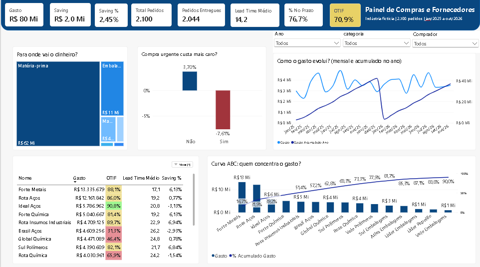

# Painel de Compras e Fornecedores | Indústria

> ⚠️ **Dados 100% fictícios**, criados para estudo. Empresas, compradores e valores não representam nenhuma organização real.

Dashboard em **Power BI** que mostra para a gestão de Suprimentos de uma indústria **para onde vai o dinheiro, quais fornecedores concentram o gasto, quem entrega no prazo e quanto se economiza** em relação aos preços de referência.



## Contexto
O setor de compras de uma indústria (borracha, aço, polímeros) atende seis categorias: Matéria-prima, Embalagens, Manutenção (MRO), EPI, Serviços e Material de escritório. A gestão precisava responder:

1. **Para onde vai o dinheiro?** Gasto por categoria.
2. **Quem concentra o gasto?** Curva ABC de fornecedores.
3. **Os fornecedores entregam certo e no prazo?** OTIF, % no prazo e lead time.
4. **Estamos comprando bem?** Saving em relação ao preço de referência.
5. **Compra urgente custa mais caro?** Saving das compras urgentes comparado ao das planejadas.
6. **Como o gasto evolui?** Gasto mensal e acumulado no ano.

## Indicadores principais
| Indicador | Resultado | O que mede |
|---|---:|---|
| Gasto | **R$ 80 mi** | Soma de quantidade × preço unitário dos pedidos |
| Saving | **R$ 2,0 mi** | (preço de referência − preço pago) × quantidade |
| Saving % | **2,45%** | Saving ÷ valor a preço de referência |
| Total de pedidos | **2.100** | Pedidos de compra de jan/2025 a nov/2026 |
| Pedidos entregues | **2.044** | Pedidos com status Entregue |
| Lead time médio | **14,2 dias** | Dias entre o pedido e a entrega |
| % no prazo | **76,7%** | Entregas até a data prevista |
| OTIF | **70,9%** | *On Time In Full*: entregue no prazo **e** com a quantidade completa |

## Principais insights
- **A matéria-prima domina o gasto:** cerca de R$ 62 mi dos R$ 80 mi (aproximadamente 78%) vão para essa categoria. Embalagens vêm em seguida, com R$ 11 mi.
- **Compra urgente custa caro:** pedidos urgentes têm saving de **−7,61%**, ou seja, são pagos acima da referência. Pedidos planejados economizam **3,70%**. Planejar melhor a demanda vira economia direta.
- **O gasto é concentrado:** pela curva ABC, os 3 maiores fornecedores (Forte Metais, Rota Aços e Ideal Aços) somam cerca de 39% do gasto, e 6 fornecedores chegam a mais de 57%.
- **Há risco nos fornecedores críticos:** Brasil Aços (**OTIF 31,3%**), Global Química (**46,4%**) e Rota Química (**65,9%**) estão entre os maiores em gasto e entregam mal. São prioridade para desenvolvimento de fornecedores ou busca de alternativas.
- **O OTIF geral de 70,9% fica abaixo do % no prazo (76,7%):** parte das entregas chega na data, mas com quantidade incompleta.

## Base de dados
Três tabelas em CSV (UTF-8, separador `;`, vírgula decimal), na pasta [`dados/`](dados/):

| Arquivo | Linhas | Conteúdo |
|---|---:|---|
| [`pedidos.csv`](dados/pedidos.csv) | 2.100 | Tabela fato: um pedido por linha, com datas, quantidades, preço pago, preço de referência, urgência, comprador e status |
| [`fornecedores.csv`](dados/fornecedores.csv) | 40 | Dimensão: nome, UF, cidade, categoria principal e porte |
| [`itens.csv`](dados/itens.csv) | 32 | Dimensão: descrição, categoria e unidade de medida |

**Modelo:** esquema estrela, com `pedidos` ligada a `fornecedores` (pela coluna `id_fornecedor`) e a `itens` (pela coluna `id_item`).

**Qualidade dos dados:** a base bruta traz inconsistências típicas de sistemas de compras, como nomes de compradores com maiúsculas e minúsculas diferentes ("Bruno Lima", "bruno lima", "BRUNO LIMA"), espaços extras no fim do nome de fornecedores e valores com vírgula decimal. Elas exigem padronização no Power Query antes da análise.

## Ferramentas
- **Power BI Desktop**: Power Query (tratamento), modelagem em esquema estrela, medidas **DAX** e visualização
- **Excel / CSV**: base de dados

## Como abrir
1. Instale o [Power BI Desktop](https://powerbi.microsoft.com/desktop/) (gratuito).
2. Baixe [`powerbi/compras-fornecedores.pbix`](powerbi/compras-fornecedores.pbix) e abra o arquivo.
3. Use os filtros **Ano**, **Categoria** e **Comprador** para explorar o painel.

## Estrutura
```
compras-fornecedores-industria/
├── dados/
│   ├── pedidos.csv
│   ├── fornecedores.csv
│   └── itens.csv
├── powerbi/
│   └── compras-fornecedores.pbix
├── imagens/
│   └── painel-compras.png
└── README.md
```

## Autora
**Gyovanna Flores**: profissional de licitações e compras em transição para análise de dados.
[LinkedIn](https://www.linkedin.com/in/gyovannaflor/)
